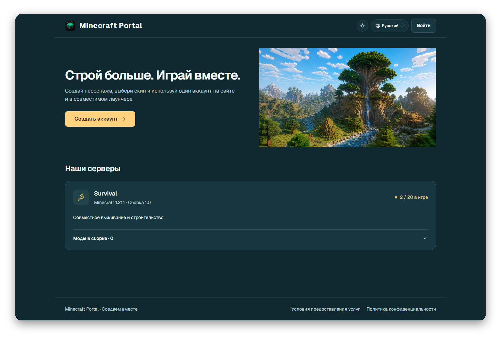
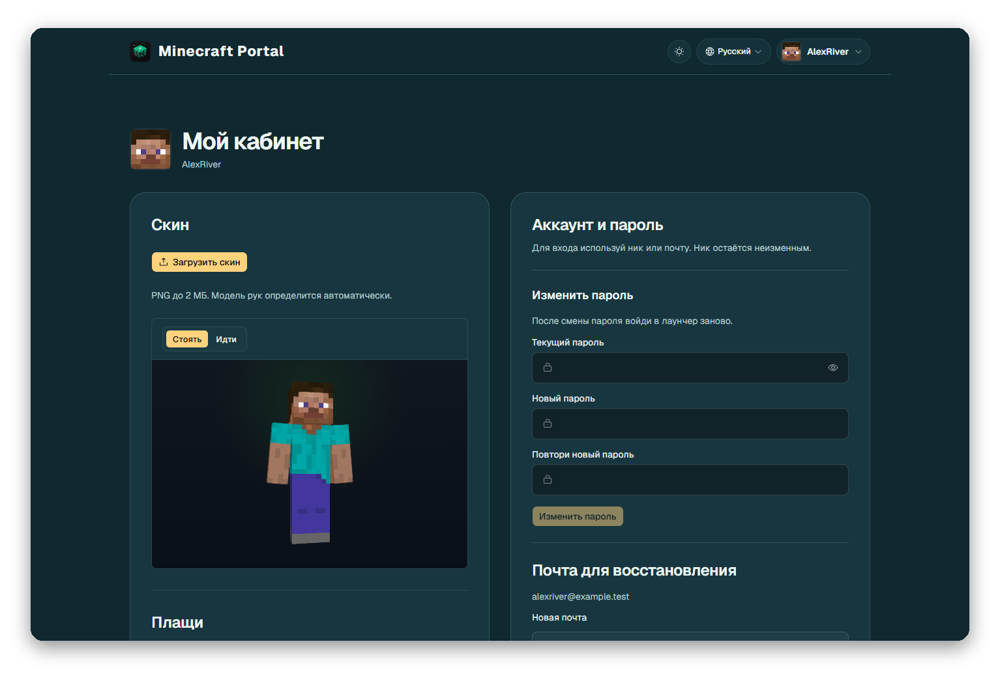

# KRWA MC Portal

Портал для своего Minecraft-сервера. Игроки создают персонажей, меняют скины и плащи и входят в совместимый лаунчер с тем же аккаунтом.

- [Установка и оформление](docs/installation.md)
- [Подключение лаунчера и сервера](docs/launcher.md)
- [Разработка, публикация и обновления](docs/development.md)

Основан на [AsterYggdrasil](https://github.com/AsterCommunity/AsterYggdrasil). [Лицензия MIT](LICENSE).
